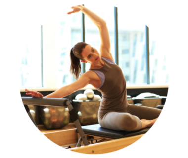
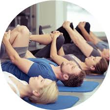

<!-- wp:image {"align":"right","id":7240,"sizeSlug":"large","linkDestination":"none","className":"is-style-default"} -->

<figure class="alignright size-large"></figure>

<!-- /wp:image -->

<!-- wp:paragraph {"style":{"typography":{"fontSize":18}}} -->

Aletli pilates, Joseph Pilates’in mat pilates hareketler serisinden yola çıkarak, kendi kas gücünü kullanamayacak durumdaki yaralı askerlerin rehabilitasyonu çalışmaları sırasında temellerini attığı ve destekleyici ekipmanlar ile hareket etmeyi sağlayan pilates egzersizlerini ifade eder.

<!-- /wp:paragraph -->

<!-- wp:columns -->

<!-- wp:column -->

<!-- /wp:column -->

<!-- /wp:columns -->

<!-- wp:paragraph {"style":{"typography":{"fontSize":18}}} -->

Mat pilates ise, Joseph Pilates’in geliştirdiği orijinal hareketler serisinden yola çıkılarak, zaman içinde geliştirilmiş, çeşitlendirilmiş ve top, lastik vb ekipmanlar ile zenginleştirilmiş; kişinin kendi kas gücü ile minder/mat üzerinde yapılan egzersizleri ifade eder.

<!-- /wp:paragraph -->

<!-- wp:columns -->

<!-- wp:column -->

<!-- /wp:column -->

<!-- /wp:columns -->

<!-- wp:image {"align":"left","sizeSlug":"large","linkDestination":"none","className":"is-style-default"} -->

<figure class="alignleft size-large"></figure>

<!-- /wp:image -->

<!-- wp:paragraph -->

Aletli pilates mi mat pilates mi, sorusu en çok sorulan sorulardan biridir. Ve aletli pilates mat pilatesten sanki daha “üstün”müş gibi algılanır. : ) Halbuki temelde her ikisi de nefes, akıcılık, kesinlik, konsantrasyon, kontrol ve merkez/aksiyal uzama gibi aynı prensipler doğrultusunda, aynı amaca hizmet eder, hatta pek çok hareket birbirinin varyasyonu şeklindedir. Ancak aletli pilates, reformer, cadillac (trapez table), chair, barrel gibi bazı makina &amp; ekipmanlar ile kişiyi hareketin amacına bağlı olarak destekler veya zorluk derecesini artırır. Reformer üzerinde temelde yayların direncine karşı kas gücü çalıştırılıp güçlendirilirken, cadillac mattaki gibi kas gücüne dayalı hareketlerin, reformer varyasyonlarının veya yer çekime karşı güç ve/veya esnekliği arttıran hareketlerin yapılmasını mümkün kılar. Chair ve barrel gibi çeşitliliği, zorluk derecesi veya varyasyonları zenginleştiren başka ekipmanlar da bulunmaktadır ve insan bedeninin nasıl hareket ettiği konusundaki bilimsel araştırmalar arttıkça pilateste kullanılan ekipmanlar da gelişmeye devam etmektedir.

<!-- /wp:paragraph -->

<!-- wp:columns -->

<!-- wp:column -->

<!-- /wp:column -->

<!-- /wp:columns -->

<!-- wp:paragraph {"style":{"typography":{"fontSize":18}}} -->

Öte yandan top, lastik, çember gibi pilatesi zevkli veya etkili hale getiren başka pek çok küçük ekipman da kullanılmaktadır.&nbsp;

<!-- /wp:paragraph -->

<!-- wp:columns -->

<!-- wp:column -->

<!-- /wp:column -->

<!-- /wp:columns -->

<!-- wp:paragraph {"style":{"typography":{"fontSize":18}}} -->

Yani aslında biri diğerinden daha üstün veya biri diğerinden daha faydalı diye bir ayrım yok. Önemli olan doğru uygulanması için bir uzman gözetiminde, kişinin ihtiyaçları doğrultusunda ve hangisini daha keyif alarak yaptığına bağlı olarak düzenli olarak yapılması… Pilatesin en temel çıktısı, beden, zihin ve ruh bütünlüğü. Dayanıklı, sağlıklı, doğru hareket edebilen, esnek, güçlü ve fit bir beden aslında yan faydalar : )

<!-- /wp:paragraph -->

<!-- wp:quote {"className":"is-style-large"} -->
<blockquote class="wp-block-quote is-style-large">
Change happens through movement and movement heals! 

 Joseph Pilates
</blockquote>
<!-- /wp:quote -->

<!-- wp:paragraph -->

&nbsp;

<!-- /wp:paragraph -->
