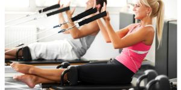
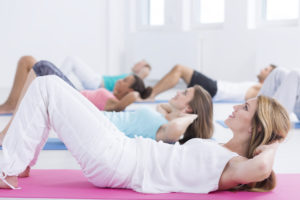
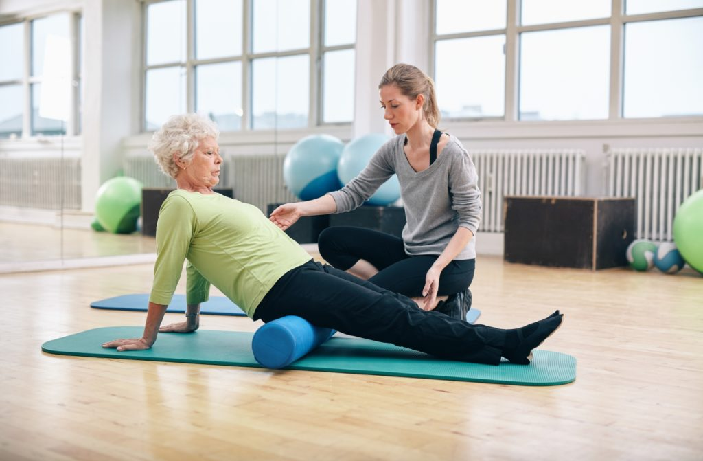
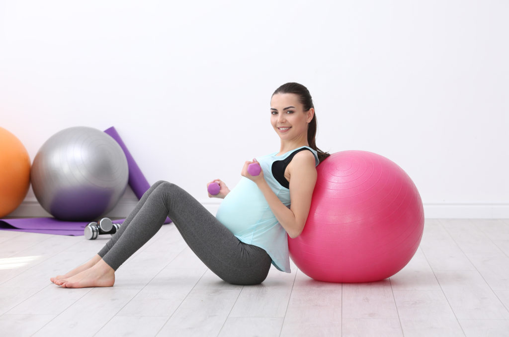

<!-- wp:columns -->

<!-- wp:column {"width":"33.33%"} -->

<!-- wp:image {"align":"left","id":7230,"width":300,"height":150,"sizeSlug":"medium","linkDestination":"none","className":"is-style-rounded"} -->
<figure class="wp-block-image alignleft size-medium is-resized is-style-rounded"></figure>
<!-- /wp:image -->

<!-- /wp:column -->

<!-- wp:column {"width":"66.66%"} -->

<!-- wp:heading {"level":3} -->
<h3><strong>· Aletli Pilates</strong></h3>
<!-- /wp:heading -->

<!-- wp:paragraph -->

Aletli pilates, Joseph Pilates’in mat pilates hareketler serisinden yola çıkarak, kendi kas gücünü kullanamayacak durumdaki yaralı askerlerin rehabilitasyonu çalışmaları sırasında temellerini attığı ve destekleyici ekipmanlar ile hareket etmeyi sağlayan pilates egzersizlerini ifade eder. 

<!-- /wp:paragraph -->

<!-- /wp:column -->

<!-- /wp:columns -->

<!-- wp:group -->

<!-- wp:group -->

<!-- /wp:group -->

<!-- /wp:group -->

<!-- wp:columns -->

<!-- wp:column -->

<!-- wp:columns -->

<!-- wp:column {"width":"66.66%"} -->

<!-- wp:heading {"level":3} -->
<h3><mark style="background-color:rgba(0, 0, 0, 0)" class="has-inline-color has-vivid-cyan-blue-color">· Mat Pilates</mark></h3>
<!-- /wp:heading -->

<!-- wp:paragraph -->

Mat pilates, Joseph Pilates’in geliştirdiği orijinal hareketler serisinden yola çıkılarak, zaman içinde geliştirilmiş, çeşitlendirilmiş ve top, lastik vb ekipmanlar ile zenginleştirilmiş; kişinin kendi kas gücü ile minder/mat üzerinde yapılan egzersizleri ifade eder. 

<!-- /wp:paragraph -->

<!-- /wp:column -->

<!-- wp:column {"width":"33.33%"} -->

<!-- wp:image {"id":7259,"sizeSlug":"medium","linkDestination":"none","className":"is-style-rounded"} -->
<figure class="wp-block-image size-medium is-style-rounded"></figure>
<!-- /wp:image -->

<!-- /wp:column -->

<!-- /wp:columns -->

<!-- /wp:column -->

<!-- /wp:columns -->

<!-- wp:group -->

<!-- /wp:group -->

<!-- wp:columns -->

<!-- wp:column {"width":"33.33%"} -->

<!-- wp:image {"id":7258,"sizeSlug":"large","linkDestination":"none","className":"is-style-rounded"} -->
<figure class="wp-block-image size-large is-style-rounded"></figure>
<!-- /wp:image -->

<!-- /wp:column -->

<!-- wp:column {"width":"66.66%"} -->

<!-- wp:heading {"level":3} -->
<h3><mark style="background-color:rgba(0, 0, 0, 0)" class="has-inline-color has-vivid-cyan-blue-color">· İleri Yaşlar için Pilates</mark></h3>
<!-- /wp:heading -->

<!-- wp:paragraph -->

Pilates, uzman bir eğitmen eşliğinde yapıldığında, her yaşta keyifle uygulanabilecek bir egzersiz yöntemidir. Kas, eklem ve iskelet sisteminin doğru hareket etmesi ve çalıştırılmasını esas aldığı için, hem yaşlılığa yatırım hem de ileri yaşlarda yaşam kalitesini arttırıcı etki gösterir. Yaşlılığa bağlı gelişen kas, eklem ve kemik yapı ile ilgili rahatsızlıkların önlenmesi veya post-rehabilitasyondaki rahatlatıcı etkisi kanıtlanmıştır. Hareket kapasitesi yüksek bir yaşam için, pilatesi güvenle yapabilirsiniz.

<!-- /wp:paragraph -->

<!-- /wp:column -->

<!-- /wp:columns -->

<!-- wp:columns -->

<!-- wp:column -->

<!-- /wp:column -->

<!-- /wp:columns -->

<!-- wp:columns -->

<!-- wp:column {"width":"66.66%"} -->

<!-- wp:heading {"level":3} -->
<h3><mark style="background-color:rgba(0, 0, 0, 0)" class="has-inline-color has-vivid-cyan-blue-color">· Hamile Pilatesi</mark></h3>
<!-- /wp:heading -->

<!-- wp:paragraph -->

Hamilelik sürecinde ve sonrasında yapılan, pelvik taban, sırt, kol ve postürü destekleyen diğer kaslara odaklanılarak yapılan bir pilates çalışma şeklidir. Değişen bedenin olası sırt ve bel ağrılarını azaltmak, bedeni güçlendirerek doğuma hazırlamak hedeflenir. Doktor onayı olması halinde tüm anne adayları pilates yapabilir. Egzersiz geçmişi olmayan anne adaylarında ilk 3 ay yapılması önerilmez. 

<!-- /wp:paragraph -->

<!-- wp:columns -->

<!-- wp:column -->

<!-- /wp:column -->

<!-- /wp:columns -->

<!-- /wp:column -->

<!-- wp:column {"width":"33.33%"} -->

<!-- wp:image {"id":7257,"sizeSlug":"large","linkDestination":"none","className":"is-style-rounded"} -->
<figure class="wp-block-image size-large is-style-rounded"></figure>
<!-- /wp:image -->

<!-- /wp:column -->

<!-- /wp:columns -->

<!-- wp:group -->

<!-- wp:columns -->

<!-- wp:column {"width":"100%"} -->

<!-- wp:columns -->

<!-- wp:column {"width":"100%"} -->

<!-- /wp:column -->

<!-- /wp:columns -->

<!-- /wp:column -->

<!-- /wp:columns -->

<!-- /wp:group -->

<!-- wp:group -->

<!-- wp:columns -->

<!-- wp:column -->

<!-- /wp:column -->

<!-- /wp:columns -->

<!-- /wp:group -->
