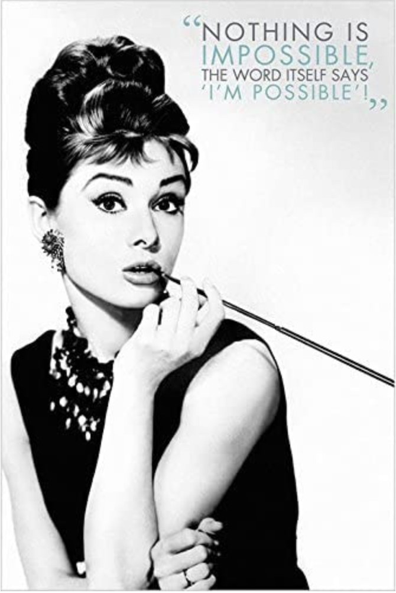

<!-- wp:paragraph -->

Geçtiğimiz ay, pilateslab.studio adresli web sayfamı kapatmaya ve burada birleştirmeye karar verip ilgili domainimi yenilememiştim. Yedeklemeyi tam yapmadığım için, adeta bir Murphy etkisi ile bir sürü şey elbette ve tabiki uçtu :D ve bir kaç gün, yeni temayı ayarlama &amp; birleştirme işiyle ilgili büyük bir karmaşa yaşadım, bazı şeyleri _henüz_ tam istediğim gibi toparlayamadım ama sanırım bir şeye benzedi gibi. 

<!-- /wp:paragraph -->

<!-- wp:columns -->

<!-- wp:column -->

<!-- /wp:column -->

<!-- /wp:columns -->

<!-- wp:paragraph -->

Pilates ne alaka, kısmını bilmeyenler için, hikayesi eski : ) 2014 yılının Haziran ayıydı ve hiç farkında olmadan yeni bir hayat için düşünce tohumları ektiğim bir yaz tatiliydi. Bu yola nasıl düştüğümle ilgili detaylar eski, tatlı bir hikaye... : ) Aldığım eğitimler ise "<a href="http://www.ozlemhoscan.com/kimdir/" target="_blank" rel="noreferrer noopener">eğitimler</a>" sekmesi altında...

<!-- /wp:paragraph -->

<!-- wp:columns -->

<!-- wp:column -->

<!-- /wp:column -->

<!-- /wp:columns -->

<!-- wp:paragraph -->

Yeni bir meslek edinmiş olmanın veya yeni bir alanda çalışarak yeni bir hayat kurarak hayatı sürdürmeye çalışmanın,  çeşitli güzel veya zor yanları elbette var. Ama her şekilde değişik bir tazelenme hali... Sadece bir sürü yeni şey öğrenme fırsatı veya yeni 'challenge'lar ile gelişim alanı açıldığı için değil; cesaretin insana kattığı bir hoşnutluk, yenilenen bir özgüven, ataleti sırtından atmanın verdiği bir hafifleme (ki pazarlama iletişimi çok hareketli ve sosyal açıdan yoğun bir meslek olduğu halde rutin veya atalet her zaman beliriyor) ve günün sonunda _<em>elbette ki başarı tanımlarınıza bağlı olarak</em>_   iyi ki yapmışım, diyebilmek, düz bir çizgide kalmadan etki/tepki veya sebep/sonuç ilişkileri içinde yeni yollardan yürüyebilmek, yeni yollar çizebilmek insanı iyi hissettiriyor. 

<!-- /wp:paragraph -->

<!-- wp:columns -->

<!-- wp:column -->

<!-- /wp:column -->

<!-- /wp:columns -->

<!-- wp:paragraph -->

Benim gibi, epigenetik, nöroplastitite, anatomi, hareket bilimi, mindfulness, bütüncül yaşam veya tam sağlık gibi konulara fazlasıyla ilgi duyan biri için, çok ilginç, kavrayıcı, öğretici, geliştirici ve tatmin edici bir süreç ve yol haline dönüştüğünü de söyleyebilirim üstelik.

<!-- /wp:paragraph -->

<!-- wp:columns -->

<!-- wp:column -->

<!-- /wp:column -->

<!-- /wp:columns -->

<!-- wp:paragraph {"align":"left"} -->

Ama kendimi hiç bir zaman yaptığım iş, gittiğim okul, aldığım titr vs gibi etiketlerle ifade etmeyi ve tanımlamayı sevmediğim ve benimsemediğim için, yarın bakarsınız marangozluk yapmaya başlarım veya dikiş dikerek yaşarım. (İtiraf etmeliyim özellikle marangozluk fena ilgimi çekiyor hsssjj) Yeni şeyler öğrenmek, farklı şekillerde gelişmek hayata bir bakış ve kendini ifade şekli benim için ve zamanı keyifli hale getiriyor. Lisedeyken önce endüstri mühendisi olmayı düşünürken, son sene gördüğü örnekler karşısında, sırf "eğlenerek yaptığı bir meslek edinmek istediğine karar verdiği" için :D fikir ve bölüm değiştirip turizm okumak isteyen, sonra da okulun ilk senesi asla bu işi yapmayacağını anlayıp :D yıllarca pazarlama iletişimine yönelen, iş hayatına başladığında 'ileride' pastacılık veya yunus bakıcılığı yapma gibi hayalleri olan bir insan evladıyım sonuçta :D ve bana göre bir insan, her zaman her yaşta "bir şey" olabilir; yeter ki istesin ve gerekli koşullara erişmek imkansızımsı :D olmasın. Kaldı ki "<em>even the word itself says i'm possible</em>" dememiş mi canım kadın Audrey! (mavi kalp) 

<!-- /wp:paragraph -->

<!-- wp:image {"id":7592,"width":168,"height":251,"sizeSlug":"large","linkDestination":"none","align":"center","className":"is-style-default"} -->
<figure class="wp-block-image aligncenter size-large is-resized is-style-default"></figure>
<!-- /wp:image -->

<!-- wp:columns -->

<!-- wp:column -->

<!-- /wp:column -->

<!-- /wp:columns -->

<!-- wp:paragraph -->

Hayatımın son 20 yılına bakınca, kendimle ilgili en sevdiğim, en iyi öğrendiğim kısım ve 'kendini gerçekleştirmek'den anladığım bu bile olabilir :) Nerede ve nasıl mutluysam, "fikri hür, vicdanı hür, irfanı hür" olarak özgürce, sorumluluklarımın bilincinde, ilkelerimle, özsevgi, özsaygı, özşefkat içerisinde, hatalar yaparak ve hatalarımdan öğrenerek, hayatın getirdikleri karşısında gerektiği kadar esnek, gerektiği kadar dirençli, gerektiği kadar güçlü durarak, üreterek, paylaşarak, katkı sağlayarak, çoğaltarak, denge ve hoşnutluk içinde yaşamak... 

<!-- /wp:paragraph -->

<!-- wp:paragraph -->

<!-- /wp:paragraph -->

<!-- wp:paragraph -->

Ah! Çok yeri ve zamanı, yıllardır panomda duran, yazarını bilmediğim bir alıntıyı buraya bırakarak yeni temam ile birleştirilmiş sayfalarıma merhaba diyor, sizlere içten sevgilerimi gönderiyorum :) Zira aşağıdaki bu cümlelerden biri ile hayatıma dokunan pek çok harika insandan biri olduğunuza eminim. İspat edemem ama eminim. :D  

<!-- /wp:paragraph -->

<!-- wp:quote {"className":"is-style-default"} -->
<blockquote class="wp-block-quote is-style-default"><!-- wp:paragraph -->

<strong>Başarı, </strong>  

<!-- /wp:paragraph -->

<!-- wp:paragraph -->

Sık sık gülmek ve çok sevmektir. Akıllı insanların saygısını ve çocukların sevgisini kazanmaktır. Dürüst eleştirmenlerin onayını almak, sahte dostların arkadan vurmalarına dayanmaktır. Güzeli sevmektir. Herkesteki en iyiyi bulmaktır. Karşılık beklemeyi hiç düşünmeden kendiliğinden vermektir. Geride ister sağlıklı bir çocuk, ister kurtarılmış bir ruh, ister bir parça yeşil bahçe, ister iyileştirilen bir sosyal durum bırakarak dünyanın iyileşmesine katkıda bulunmaktır. Gönlünce eğlenmek ve gülmek, kendinden geçerek şarkı söylemektir. Tek bir kişi bile olsa, birinin sizin varlığınızdan ötürü daha rahat nefes aldığını bilmektir. 

<!-- /wp:paragraph -->

<!-- wp:paragraph -->

İşte bu başarılı olmaktır.

<!-- /wp:paragraph --></blockquote>
<!-- /wp:quote -->

<!-- wp:columns -->

<!-- wp:column -->

<!-- /wp:column -->

<!-- /wp:columns -->

<!-- wp:paragraph -->

01 Eylül 2021, İstanbul

<!-- /wp:paragraph -->

<!-- wp:columns -->

<!-- wp:column -->

<!-- /wp:column -->

<!-- /wp:columns -->
